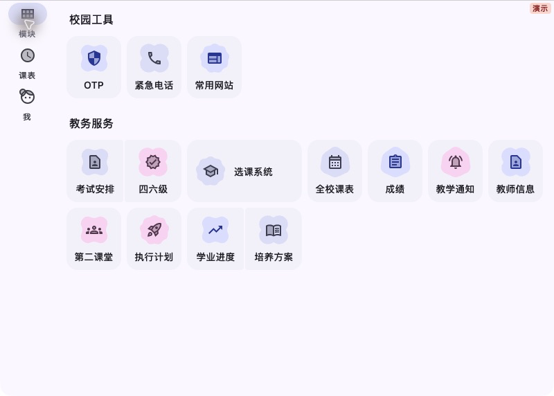
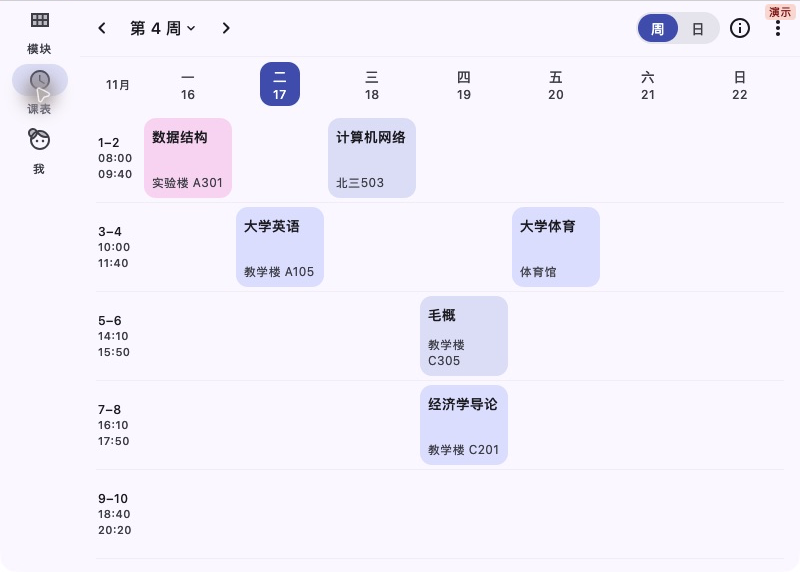
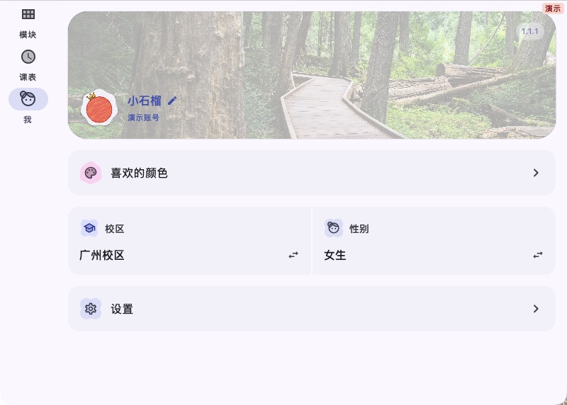
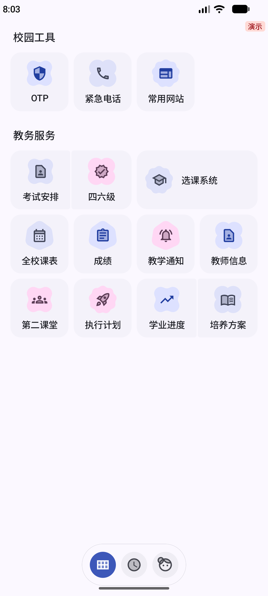
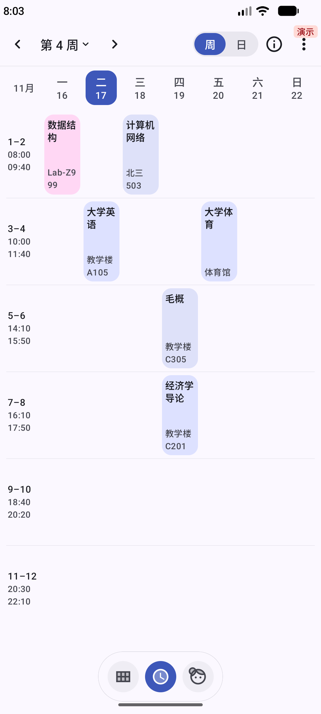
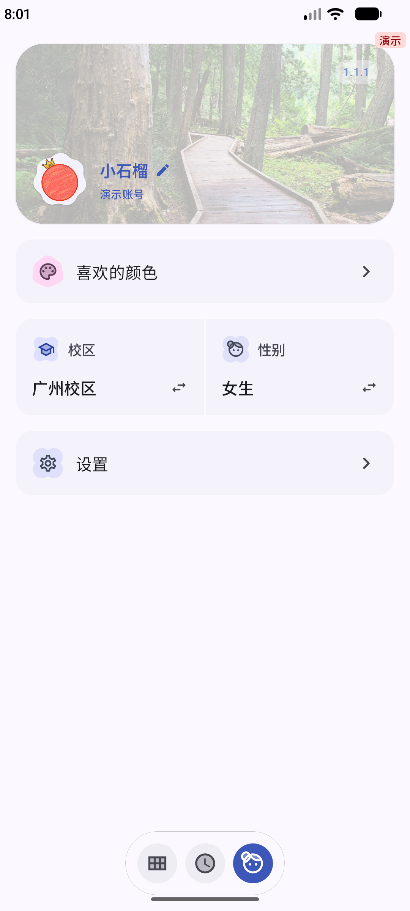

# 小石榴 - 广财 GDUFE 教务系统软件

  

> 小石榴是一款直连学校官网的**非官方**广财教务系统客户端，由广财 21 级某不知名电商学长开发维护，无广告、无付费功能。
> 如果方便的话可以点一下仓库的星标，这是对项目最大的支持。

> 小石榴现已借助 AI 重做完成。
> 由于没有账号测试，潜在的问题无法发现，目前处于测试阶段。
> 新的小石榴与[旧版](https://github.com/Kiteio/Punica)可以并存，重要的操作建议在旧版完成。
> 如有问题，请新建 issues 或发送邮箱 `changwingchow@163.com`。

<table>
  <tr><th colspan="3">桌面端 · 亮色演示</th></tr>
  <tr><th width="33%">模块</th><th width="33%">课表</th><th width="33%">我</th></tr>
  <tr>
    <td></td>
    <td></td>
    <td></td>
  </tr>
</table>

<table>
  <tr><th colspan="3">手机端 · 亮色演示</th></tr>
  <tr><th width="33%">模块</th><th width="33%">课表</th><th width="33%">我</th></tr>
  <tr>
    <td></td>
    <td></td>
    <td></td>
  </tr>
</table>

## 数据与隐私

- 软件所有代码开源。
- 应用内的数据都存储在本地设备。
- 应用会直接访问学校相关服务，不经自建服务器。

## 支持平台

### Android

- `Pomegranate-x.x.x-android-arm64-v8a-release.apk` 是正式签名安装包，仅适用于 ARM 64 位 Android 设备，包括大多数手机和平板。

### Desktop

- <code>Pomegranate-x.x.x-<strong>windows</strong>-x64.msi</code>：Windows 安装包。
- <code>Pomegranate-x.x.x-<strong>windows</strong>-x64-portable.zip</code>：Windows 免安装包。
- <code>Pomegranate-x.x.x-<strong>macos</strong>-arm64.dmg</code>：Apple Silicon Mac 安装包。
- <code>Pomegranate-x.x.x-<strong>linux</strong>-x64.deb</code>：Linux 安装包。

### iOS（模拟器，经费不足）

- <code>Pomegranate-x.x.x-<strong>ios-simulator</strong>-arm64.zip</code>：模拟器包，不能安装到 iPhone。

## 许可证

本项目采用 MIT 许可证，详见 [LICENSE](LICENSE)。

This project is licensed under the MIT License - see the [LICENSE](LICENSE) file for details.

你可以自由使用、修改、分发本项目（含商业用途），只需保留版权声明与许可证原文。
第三方依赖各自遵循其原有协议，例如验证码识别用到的 Tesseract 训练数据为 Apache-2.0。
